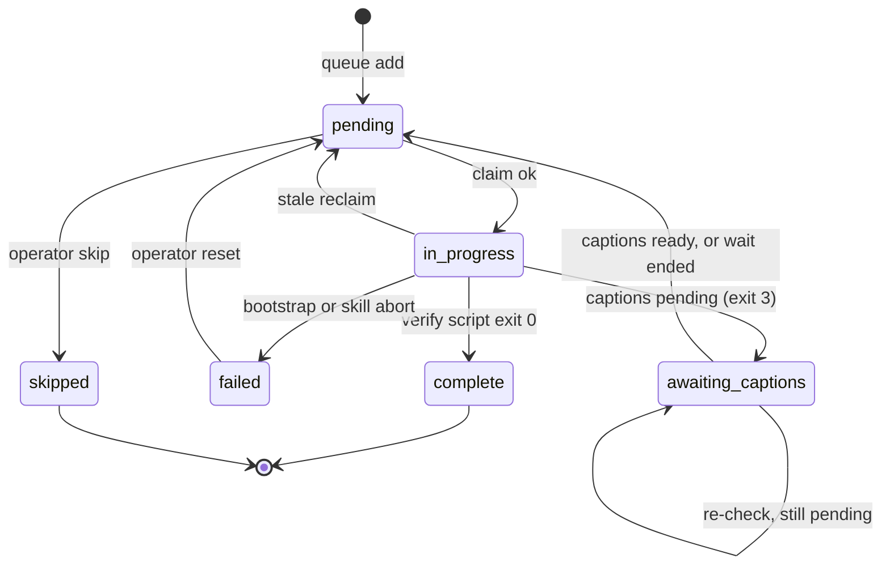

# Watch queue

Epic-level durable queue for batching public video URLs before `/knowledge:video-digest watch`. **V1 = markdown table + filesystem claim stubs**, with no JSON queue schema.

**One queue, every source.** The on-disk epic directory stays the literal `youtube-watch` (a stable storage-format identifier, not a source claim), and there is one `claims/` namespace. Source is **never a directory level**. It lives in slice metadata (`watch.json` `sourceUrl`). A mixed YouTube + X batch shares this one queue and these claim stubs; nothing about a consumer's existing `.work/` tree changes.

- [Artifacts](#artifacts)
- [Table columns](#table-columns)
- [Skill actions](#skill-actions)
- [Claim protocol (every dequeue)](#claim-protocol-every-dequeue)
- [Queue row lifecycle](#queue-row-lifecycle)
- [Materialize `QUEUE.md`](#materialize-queuemd)
- [Companion primary sources (optional at queue)](#companion-primary-sources-optional-at-queue)
- [Preflight (every `queue` add)](#preflight-every-queue-add)

## Artifacts

| Path | Role |
| --- | --- |
| `.work/<watch-epic>/QUEUE.md` | Human-readable queue table (live) |
| `.work/<watch-epic>/claims/<n>.json` | Row-level exclusive claim (concurrency only) |
| `templates/queue.md` | Empty table copied on first `queue` use |

Per-video work stays under `.work/<watch-epic>/<video-slug>/` (`watch.json`, slices). The queue answers **which URL next**, not phase internals.

Deferred queue evolutions (a JSON queue, a CLI, leases, unattended drain) are recorded in
[reference/ingest-deferred-decisions.md](../../../reference/ingest-deferred-decisions.md), section 6, "video-digest queue
evolutions". Keep the `claims/<n>.json` shape stable so a later implementation can ingest it.

## Table columns

| Column | Meaning |
| --- | --- |
| `#` | 1-based row index (stable after insert; do not renumber on complete) |
| `URL` | Canonical source URL (canonicalized by the source layer before it is written) |
| `video-id` | The source's slice key, and the dedupe key. YouTube: the 11-char video id. X: the status id (`display_id`). See `../reference/sources/`. |
| `title` | Video title from the preflight probe (escaped + 60-char capped), so the row is legible without opening the URL |
| `channel` | `Display Name (@handle)` from the preflight probe |
| `slug` | Filled after first bootstrap (`derive-video-slug.js`); may be pre-filled at queue time when companion brief materialized |
| `status` | `pending` \| `in_progress` \| `awaiting_captions` \| `complete` \| `failed` \| `skipped` |
| `notes` | Operator/agent notes (terminal label, error one-liner, or `companion — source/companion-sources.md`); an `awaiting_captions` row's next check time and deadline, written by `hold` |

Claim metadata (`claimedAt`, `claimedBy`) lives in `claims/<n>.json`, not in the table, so two terminals do not fight over the same cell semantics.

## Skill actions

| Action | Behavior |
| --- | --- |
| `queue <url> [url...]` | Ensure `QUEUE.md` exists (from template); **preflight each URL** (validate + fetch title/channel); append rows; **dedupe by video-id** |
| `queue list` | Display table + list active claim files under `claims/`; name each `awaiting_captions` row with the next check time from its `notes` |
| `watch` (no URL) | FIFO: first row `queue-claim.js next` lists with successful exclusive claim |
| `watch <n>` | Claim row `#n` only (parallel path across terminals) |
| `watch <url>` | Unchanged: direct single-video watch |

## Claim protocol (every dequeue)

**Order: claim stub first, table second.**

1. Run exclusive claim (skill or CLI):

```bash
node "<skill-dir>/extraction/run.mjs" --data-dir "<plugin-data>" watch/queue-claim.js claim <n> [--video-id <id>]
```

Exit code `2` = row already taken. For FIFO `watch`, try the next `pending` row; for `watch <n>`, stop with a clear message rather than bootstrapping duplicate work.

1. Set row `#n` → `status: in_progress` in `QUEUE.md`. An `awaiting_captions` row claimed for
   a re-check keeps its status until the re-check resumes it ([Caption wait](#caption-wait-awaiting_captions)).
2. Read URL from row; bootstrap, adding `--caption-wait-deadline "<deadline>"` when the row's
   `notes` record a caption-wait deadline:

```bash
node "<skill-dir>/extraction/run.mjs" --data-dir "<plugin-data>" watch/run-watch.js "<url>"
```

1. Exit `3` means captions pending: hold the row (below) and release the claim; do not mark it
   `failed`.
2. Execute skill phases 2–9 (or `run-resume.js` if slice exists and temp valid).
3. On verify script exit 0 → row `complete`, with any `captionWait` note from `run-watch.js`
   copied into `notes`; on unrecoverable failure → `failed` + note.
4. Release claim:

```bash
node "<skill-dir>/extraction/run.mjs" --data-dir "<plugin-data>" watch/queue-claim.js release <n>
```

### FIFO auto-dequeue (`watch` with no URL)

List the candidates, in `#` order:

```bash
node "<skill-dir>/extraction/run.mjs" --data-dir "<plugin-data>" watch/queue-claim.js next
```

It lists each unclaimed `pending` row, and each unclaimed `awaiting_captions` row whose next check
time has come, marked `recheck: true`; a held row before its check time is skipped. A held row
whose `notes` record no deadline (a hand-set status) is listed with `recheck: false` and watched
like a `pending` row, which starts a new caption wait. Attempt
`claim <n>` on each in turn. On `EEXIST` / exit non-zero, try the next. A `recheck` row runs the
caption re-check (below) before any watch. Stop with a clear message if no row is claimable.

### Caption wait (`awaiting_captions`)

A live-derived YouTube video whose captions are not published yet is held, not failed or digested
caption-less. The values that hold a video, the bounds, and their basis are in
`../reference/sources/youtube.md` "Caption wait for live streams".

1. **Hold.** When `run-watch.js` exits `3`, its stdout carries `nextCheckAt` and `deadline`:

   ```bash
   node "<skill-dir>/extraction/run.mjs" --data-dir "<plugin-data>" watch/queue-claim.js hold <n> --next-check "<nextCheckAt>" --deadline "<deadline>"
   ```

   The row goes `in_progress` → `awaiting_captions`, its `notes` recording both times. Release
   the claim. A `QUEUE.md` with no `notes` column cannot record them, so `hold` refuses (exit `1`).
2. **Re-check.** For a `recheck` row (claimed), re-run only the caption pass, passing the
   deadline `next` reported:

   ```bash
   node "<skill-dir>/extraction/run.mjs" --data-dir "<plugin-data>" watch/caption-recheck.js "<url>" --caption-wait-deadline "<deadline>"
   ```

   | `result` | Exit | Next |
   | --- | --- | --- |
   | `captions-ready` | `0` | `queue-claim.js resume <n>` (row → `pending`), then watch the row under the claim already held |
   | `captions-pending` | `3` | `hold <n>` again with the new `nextCheckAt`; release the claim |
   | `wait-ended` | `0` | `resume <n> --notes "<notes>"`, then watch the row: the deadline in `notes` makes `run-watch.js` fall through to ASR or `transcriptDegradation` |
   | `failed` | `1` | Report `error`, `hold <n>` again with the reported `nextCheckAt` and `deadline`, and release the claim. A failure past the deadline comes back as `wait-ended`, so the deadline bounds the wait |

### Direct runs

`watch <url>` and `transcript <url>` hold too: exit `3` with `captions pending, next check at
<time>`. Report that line; with no queue row, nothing records the wait.

### Parallel terminals

| Scenario | Guidance |
| --- | --- |
| **Intended parallel** | Terminal A: `watch 2`. Terminal B: `watch 4`. Different claim files, no conflict. |
| **Serial drain** | One terminal repeats `watch` after each video completes. |
| **Two auto-`watch`** | Claim stub picks winner per row; loser skips to next `pending` or reports queue busy. |
| **Same row twice** | Second `claim <n>` fails. Stop; do not bootstrap duplicate work. |

**Operator rule:** For predictable parallel, prefer **`watch <n>` per terminal**.

### Stale reclaim

If `claims/<n>.json` exists and `claimedAt` is older than **7 days**, skill may:

```bash
node "<skill-dir>/extraction/run.mjs" --data-dir "<plugin-data>" watch/queue-claim.js stale-check
```

`stale-check` owns the whole reclaim: for each stale stub it deletes the stub and resets row `#n` from `in_progress` → `pending` in `QUEUE.md` (output keys `released` and `reset`). The agent does not repeat either step.

The output also lists `orphaned`: `in_progress` rows with no stub (a run crashed before writing one). Their age is unknown, so `stale-check` leaves them; the agent decides per row whether to reset it to `pending`.

`stale-check` never resets or orphans an `awaiting_captions` row. Its `captionRecheckDue` key lists the unclaimed ones whose next check time has come.

`claim` exits `1` when row `<n>` is not in `QUEUE.md`. Pass `--claimed-by <name>` to record the session holding the claim; the default names the short-lived CLI process (`<host>-pid<n>`).

## Queue row lifecycle



Row `status` and `notes` in `QUEUE.md` are the epic-level record when a slug completes or fails.

## Materialize `QUEUE.md`

On first `queue` action (canonical epic dir: `youtube-watch`):

1. `mkdir -p .work/<watch-epic>/claims`
2. Copy `templates/queue.md` → `.work/<watch-epic>/QUEUE.md` if missing
3. Preflight each URL (below), then append rows with the next `#` index. **Do not renumber existing rows**

Paths here are relative to the resolved work root, not always the repo root. See `output-contract.md`.

## Companion primary sources (optional at queue)

When the operator supplies companion URL(s) with queue intent, record them before watch. **SSOT:** `companion-primary-sources.md`. Template: `templates/companion-source-brief.md`.

1. After preflight `enqueue`, derive `video-slug` from `displayTitle` + the slice key.
2. Write `.work/<watch-epic>/<video-slug>/source/companion-sources.md` (section fan-out table + integration checklist).
3. Pre-fill `slug` on the `QUEUE.md` row; set `notes` → `companion — source/companion-sources.md`.

## Preflight (every `queue` add)

Before appending rows, validate each URL and fetch its title + channel through the same auth-fallback path acquisition uses (a bot-checked video that `watch` could acquire with cookies is NOT rejected at queue time):

```bash
node "<skill-dir>/extraction/run.mjs" --data-dir "<plugin-data>" acquisition/preflight-metadata.js "<url>" ["<url>"...]
```

Emits a JSON array (one entry per URL). Per entry use `action` to decide:

| `action` | `status` | What to do |
| --- | --- | --- |
| `enqueue` | `ok` | Append the row; fill `title`/`channel` from `displayTitle`/`displayChannel`; copy `note` into `notes` (empty, except a live or just-ended stream's live-stream note) |
| `enqueue` | `transient` | Append the row (link is real, just blocked this session by bot-check/auth/network); copy `note` into `notes` |
| `reject` | `unavailable` | Do **not** enqueue (removed / private / 404); report to the user |
| `reject` | `invalid-url` | Do **not** enqueue (no supported source claims the URL); report to the user with the supported-source list |

URL acceptance and failure classification are the **owning source adapter's** (`acceptForEnqueue`
and its declared error patterns), so no YouTube-shaped assumption reaches an X URL. Only a *fatal*
classification rejects. Everything else, whether bot-check, auth, network, or unclassified, enqueues as
`transient`.

**A 0-video X post enqueues.** Sources declaring media-optional results have preflight pass
`--ignore-no-formats-error`, so a post with no video reports metadata instead of erroring and
takes the `enqueue` / `ok` row like any other. Its `title` / `channel` cells may be blank for a
link post, whose text is not recoverable; a link post's `note` reads `link post, no video (empty media)`,
so copy it into `notes`. A removed or nonexistent status (probe succeeds, but no uploader, description or
counts) is the `reject` / `unavailable` row. Acquisition also fails such a post as
`X post unavailable`, which is permanent: mark the row failed instead of retrying. A deleted post was not
probed and may fail as `X acquisition degraded`; stop retrying one id after 3 such degraded failures.
See `../reference/sources/x.md`.

`displayTitle` / `displayChannel` are already markdown-escaped (`\` → `\\`, `|` → `\|`) and title-capped, so paste them directly. Dedupe by `videoId` against existing rows. CLI exit code is `2` when any URL resolved to `reject`.
